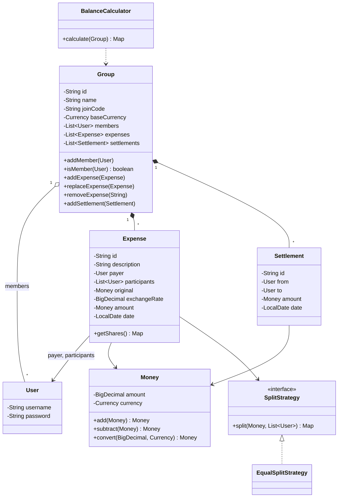
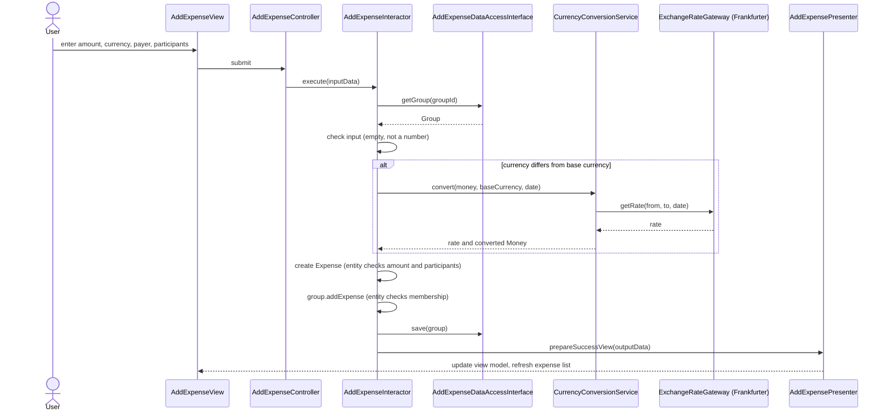
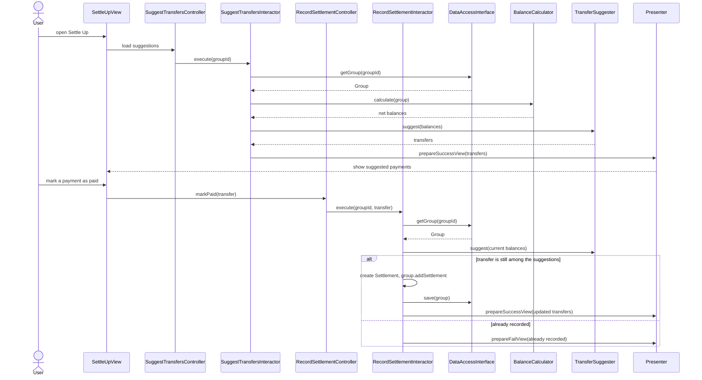

# Splitter (??? we NEED a better name)
## Team Information
### Team Members
- Anahita Pathak
- Heer Desai
- Saanvi Tyagi
- Saksham Garg
---
## Project Description
### Domain
Personal finance: shared expense tracking and splitting.

### Description
Splitter is a Java Swing desktop app that helps groups of people (roommates, friends on a trip, club members) keep track of shared expenses and work out who owes whom. Users create a group, log expenses as they happen, and the app splits each cost among the members involved. It keeps a running balance for every member and suggests the fewest payments needed to settle all debts. As an implemented extension, expenses can be entered in different currencies and converted using the Frankfurter exchange-rate API, and group data is saved so it's still there the next time the app is opened.

---
## User Stories
### User Story 1
As a new user, I want to sign up and log in with my own account, so that my groups and expenses are saved and only visible to me and the members of my group.
### User Story 2
As a user, I want to create a group, share a join code so my friends can join, and see everyone in the group, so that we can track shared expenses together.
### User Story 3
As a group member, I want to record payment information, and edit or delete an expense if I made a mistake, so that I can accurately keep track of my expenses.
### User Story 4
As a group member, I want to see a summary of who owes whom, and get a suggestion for the fewest payments that clear all debts, so I can pay people back and record that payment once it is made.

---
## Use Cases
### Story 1
### Use Case 1: Sign Up (MVP)
#### Main Success Scenario:
+ User opens the app and chooses "Sign Up".
+ User enters a username, a password, and confirms the password.
+ System validates the input, checks the username is not already taken, and saves the new account.
+ System logs the user in and shows their home screen.

#### Alternate Scenarios:
+ A field is empty or the passwords don't match: show an error, nothing saved.
+ Username is already taken: show an error, nothing saved.

### Use Case 2: Log In (MVP)
#### Main Success Scenario:
+ User enters their username and password and chooses "Log In".
+ System checks the credentials against saved accounts.
+ System loads the user's groups and shows their home screen.

#### Alternate Scenarios:
+ Username doesn't exist or password is wrong: show "Incorrect username or password".
+ A field is empty: show an error.

### Use Case 3: Log Out
#### Main Success Scenario:
+ User chooses "Log Out".
+ System ends the session and returns to the login screen.

### Story 2
### Use Case 1: Create Group (MVP)
#### Main Success Scenario:
+ Logged-in user chooses "Create Group" and enters a group name.
+ System validates the name, creates the group with the user as its first member, and generates a unique join code.
+ System saves the group and shows the group page with its join code.

#### Alternate Scenarios:
+ Group name is empty: show an error, nothing saved.
+ Generated code is already in use: system generates a new one.

### Use Case 2: Join Group (MVP)
#### Main Success Scenario:
+ User chooses "Join Group" and enters a join code.
+ System finds the group with that code and adds the user as a member.
+ System saves the change and shows the group page.

#### Alternate Scenarios:
+ Code doesn't match any group: show "Invalid join code".
+ User is already a member: open the group without adding them twice.

### Use Case 3: View Members (MVP)
#### Main Success Scenario:
+ User opens a group they belong to.
+ System displays the group name, its join code, and a list of all members.

#### Alternate Scenarios:
+ User is the only member: show the list with just them and remind them to share the join code.

### Story 3
### Use Case 1: Add Expense (MVP)
#### Main Success Scenario:
+ User opens a group and chooses "Add Expense". 
+ User enters an amount and description, selects who paid, and selects which members were involved. 
+ System validates the input and splits the amount equally among the involved members. 
+ System saves the expense to the group and shows it in the expense list.

#### Alternate Scenarios:
+ Amount is empty, zero, negative or not a number: show an error, nothing saved. 
+ No payer or no participants selected: show an error, nothing saved. 
+ Payer or participant is not a member of the group: reject the expense.

### Use Case 2: Edit Expense
#### Main Success Scenario:
+ User selects an existing expense and chooses "Edit". 
+ User changes the amount, description, payer or participants. 
+ System validates the new values, saves the changes, and the group's balances update automatically.

#### Alternate Scenarios:
+ Invalid input shows an error and the original expense is unchanged. Expense no longer exists: show an error.

### Use Case 3: Delete Expense
#### Main Success Scenario:
+ User selects an expense and chooses "Delete".
+ System asks for confirmation.
+ System removes the expense and the group's balances update automatically.

#### Alternate Scenarios:
+ User cancels at the confirmation step and nothing changes.

### Use Case 4: Add Expense in a Foreign Currency (Extension)
#### Main Success Scenario:
+ In "Add Expense", the user picks a currency that differs from the group's base currency (e.g., EUR in a CAD group). 
+ System requests the exchange rate for the expense's date from the Frankfurter API. 
+ System converts the amount to the group's base currency and stores the original amount, original currency, rate used, and converted amount with the expense. 
+ System splits the converted amount among the involved members and shows the expense with both amounts.

#### Alternate Scenarios:
+ API is unreachable or returns an error, then show a clear message and do not save the expense. 
+ Currency is not supported by the API, then show an error, nothing saved.  
+ Currency equals the group's base currency, then skip the API call and use a rate of 1.

### Story 4
### Use Case 1: View Balances (MVP)
#### Main Success Scenario:
+ User opens a group and chooses "Balances". 
+ System calculates each member's net balance from all expenses and recorded settlements. 
+ System displays a summary of who owes whom and how much.

#### Alternate Scenarios:
+ Group has no expenses, display "All settled up".

### Use Case 2: Settle Up (MVP)
#### Main Success Scenario:
+ User chooses "Settle Up" in a group. 
+ System computes the fewest payments needed to clear all debts and displays them. 
+ After a payment is made in real life, user marks that suggested payment as paid. 
+ System records the payment once and updates the balances.

#### Alternate Scenarios:
+ No outstanding debts, display "Nothing to settle".
+ Payment already recorded, then it is not recorded a second time.

---
## Minimal Viable Product (MVP)
| Team Member | MVP Use Case |
|-------------|--------------|
| Saksham Garg | Sign Up, Log In |
| Anahita Pathak | Create Group, Join Group, View Members |
| Saanvi Tyagi | Add Expense |
| Heer Desai | View Balances, Settle Up |
---
## Entities
### Entity 1: Money (value object)

An immutable amount of money in one currency.
+ amount and currency 
+ Rounds to the currency's minor unit (2 decimals for CAD)
+ add, subtract, and convert(rate, targetCurrency)
+ Rejects mixing currencies in add and subtract

### Entity 2: User

A person with an account.
+ username (unique)
+ password

### Entity 3: Group

An aggregate that holds the members, expenses, and settlements of one group.
+ id, name, joinCode (unique), baseCurrency 
+ members, expenses, settlements 
+ No duplicate members, and an expense's payer and participants must all be members 
+ Methods: addMember, isMember, addExpense, replaceExpense, removeExpense, addSettlement 

### Entity 4: Expense

One shared cost that is immutable.
+ id, description, payer, participants, date
+ originalCurrency 
+ exchangeRate (1 if no conversion)
+ amount
+ Positive amount, at least one participant
+ getShares() returns what each participant owes

### Entity 5: Settlement

A recorded payment from one member to another.
+ id, from, to, amount, date
+ Positive amount, and from must differ from to

---
## API Usage
**API Name: Frankfurter**

**Documentation: frankfuter.dev** [https://frankfurter.dev/]

**How it is used in the program:**
Frankfurter is a free exchange-rate API that needs no API key. It is used by the Add Expense in a Foreign Currency use case, and again when an edited expense changes its amount, currency, or date.

---
## Design Diagrams
### UML Class Diagram

## Sequence Diagrams

### Add Expense in foreign currency:

### Settle Up:

---
## How to Run
[Instructions for running the program.]
1. Clone the repository.
2. Build the project and run tests.
3. Run the app by launching the Main class (app.Main) from your IDE, or from the command line.
4. Sign up for an account, create a group, and share its join code. To try joining, log out, sign up as a second user, and enter the code.

Data is saved to local JSON files in the data/folder, which is created on first run. Delete this folder to reset the app.

---
## Notes
[Any additional project information.]
